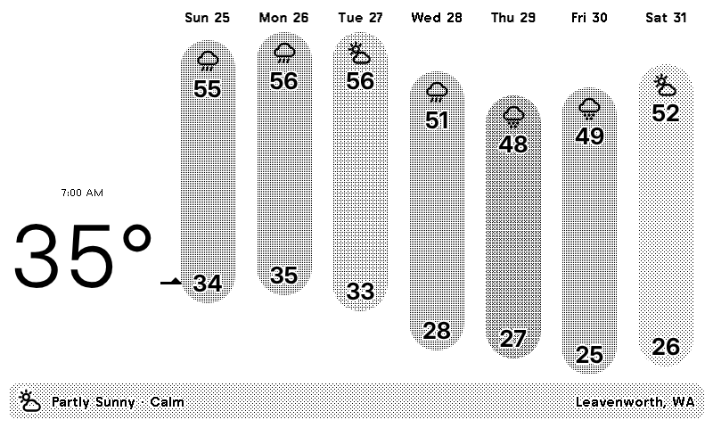
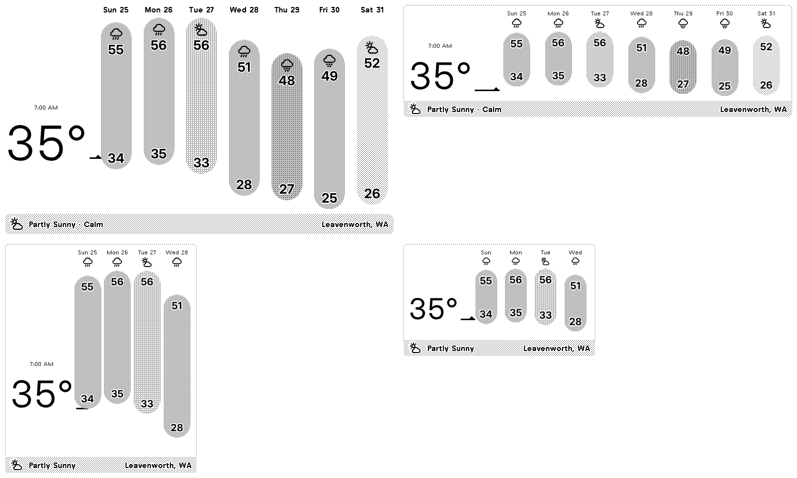

# NWS Weather Glance for TRMNL

A TRMNL private plugin that shows the week's National Weather Service forecast at a glance, styled after the
[Weather Glance](https://trmnl.com/recipes/weather-glance-181200) recipe. Each day is a "pill" spanning its low to its
high on a shared temperature scale, shaded by how rough the weather is (darker = rain, snow, storms). Current
temperature sits on the left with a marker at its spot on the scale and an arrow for the 3-hour trend. Active NWS
alerts replace the title bar text.



All four layouts (full, half horizontal, half vertical, quadrant):



Defaults to Leavenworth, WA (NWS grid `OTX/37,105`), but works for any US location.

## How it works

```
TRMNL ──poll──▶ Go service (AWS Lambda + Function URL) ──▶ api.weather.gov
                  /points → /forecast + /forecast/hourly + /alerts/active
                  returns ~2 KB of JSON shaped for the templates
```

The NWS hourly forecast is ~160 KB, over TRMNL's 100 KB polling limit. So a small Go service (`server/`) fetches
the 12-hour forecast, hourly forecast and alerts in parallel and boils them down to what the Liquid needs. That
includes precomputed pill positions, icons and severity shades.

The current temperature is a measured observation, not the forecast for this hour. It is taken from the first
source with a reading less than 2 hours old:

1. forecast.weather.gov's point-forecast JSON (`MapClick.php?FcstType=json`), the same feed behind the
   "Current conditions" box on the NWS web page. For Leavenworth that is station LVN11. This endpoint is
   undocumented, but it's the only place LVN11 is current; api.weather.gov's copy of LVN11 has been days behind.
2. The nearest api.weather.gov observation station with a fresh reading (e.g. KEAT, Wenatchee airport).
3. The hourly forecast for the current hour.

The payload's `now.source` field says which one was used (`LVN11`, `KEAT`, … or `forecast`), and `now.observed_at`
gives the reading's local time, which is shown above the big temperature.

## Layout

```
src/                 TRMNL plugin (trmnlp format)
  settings.yml       polling URL + form fields
  shared.liquid      styles, icons, and the glance/title bar templates
  full.liquid …      one thin view per size
server/              Go service
  main.go            Lambda (Function URL) handler or plain HTTP server
  glance.go          NWS → glance payload (day pairing, severity, scale)
  nws.go             api.weather.gov client
  template.yaml      AWS SAM template
.trmnlp.yml          local preview config
```

## Deploy the service to AWS

With the [SAM CLI](https://docs.aws.amazon.com/serverless-application-model/latest/developerguide/install-sam-cli.html):

```sh
cd server
sam build
sam deploy --guided   # set AccessToken to a random string; set NwsUserAgent to include your contact
```

The `ServiceUrl` output is your Function URL. It runs on `provided.al2023` arm64 with 128 MB and costs effectively
nothing at a 30-minute refresh.

Without SAM, run `make zip` and upload `server/dist/glance.zip` to a new Lambda function: runtime "Amazon Linux 2023",
arm64, handler `bootstrap`. Then enable a Function URL with auth type NONE, and optionally set the `ACCESS_TOKEN` and
`NWS_USER_AGENT` environment variables.

Try it:

```sh
curl "https://<id>.lambda-url.<region>.on.aws/?lat_lon=47.5962,-120.6615&token=<AccessToken>"
```

Query parameters: `lat_lon` (required), `units` (`us` or `si`), `name` (location label), `days` (1–7), and `token`.

## Install the plugin on TRMNL

With [trmnlp](https://github.com/usetrmnl/trmnlp) (`gem install trmnl_preview`):

```sh
trmnlp login
trmnlp push
```

Or create a Private Plugin by hand: strategy **Polling**, paste the `polling_url` and `custom_fields` from
`src/settings.yml`, and copy each `src/*.liquid` file into the matching markup tab (`shared.liquid` → Shared).

Then fill in the plugin settings:
- **Service URL**: the Function URL from above.
- **Access token**: your `AccessToken`, if you set one.
- **Location**: defaults to Leavenworth, WA.
- **Temperature unit**: Fahrenheit or Celsius.

## Develop locally

```sh
cd server && go test ./... && go run .   # serves on :8080
trmnlp serve                             # previews at http://localhost:4567 using .trmnlp.yml
trmnlp lint
```

`trmnlp` warns that TRMNL itself can't poll `localhost`. That's expected for local preview only. Set
`GLANCE_SERVICE_URL` to preview against your deployed Lambda instead. If Liquid reports "Invalid template encoding",
run with `LANG=C.UTF-8`.

## Shading

Severity comes from the NWS short forecast text plus precipitation chance:

| Severity | Example                                   | Pill       |
|---------:|-------------------------------------------|------------|
| 0        | Sunny, Clear                              | `gray-75`  |
| 1        | Mostly Sunny, Partly Cloudy               | `gray-70`  |
| 2        | Mostly Cloudy, Fog, Partly Sunny w/ rain later | `gray-65` |
| 3        | Chance / Likely Rain Showers              | `gray-60`  |
| 4        | Rain And Snow Showers Likely              | `gray-55`  |
| 5        | Thunderstorms, Freezing Rain, Heavy Snow  | `gray-45`  |
