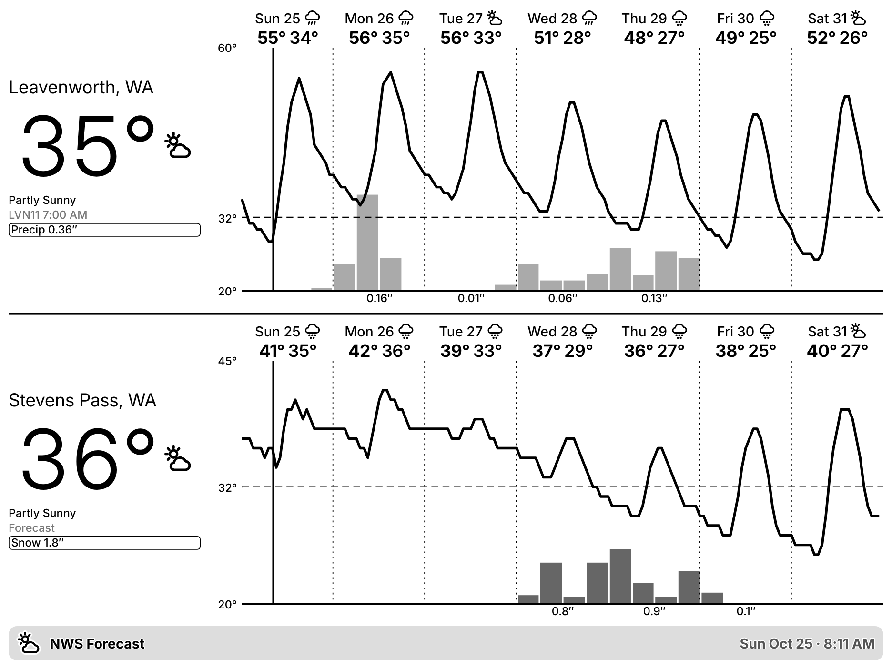
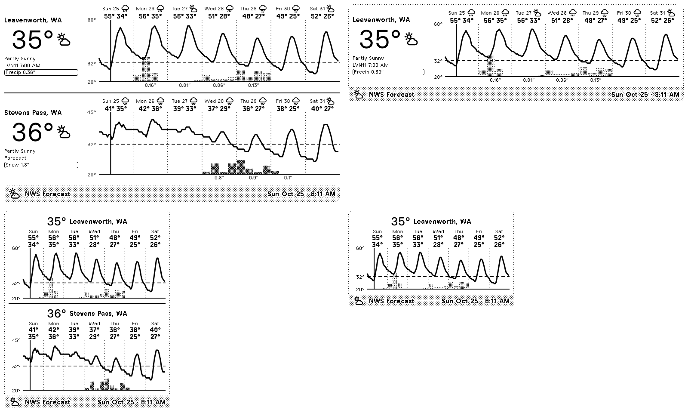

# NWS Forecast Chart for TRMNL

A TRMNL private plugin that charts the week's National Weather Service forecast for one or more places, stacked
one above the other. For each location you get:

- the current temperature (measured where possible, see below) and conditions
- each day's forecast high and low, with an icon
- an hourly temperature line for the week, a dashed freezing line, and a marker at the current time
- 6-hour snowfall bars when snow is in the forecast, otherwise liquid precipitation bars, plus daily totals

Defaults to Leavenworth, WA and Stevens Pass, WA. Shown on a TRMNL X (1872×1404, 16 grays):



On the original TRMNL (800×480, 1-bit), in full, half horizontal, half vertical and quadrant layouts:



The earlier single-location "Weather Glance" design (day pills shaded by severity) is saved under the git tag
`glance-v1`:


## How it works

```
TRMNL ──poll──▶ Go service (Vercel or AWS Lambda) ──▶ api.weather.gov (+ forecast.weather.gov)
                  for each location, in parallel:
                  /points → /forecast + /forecast/hourly + /gridpoints + /alerts/active + observations
                  returns ~4 KB of JSON per location, shaped for the templates
```

The NWS data is far over TRMNL's 100 KB polling limit: about 160 KB for the hourly forecast and 250 KB for the
gridpoint data, per location. So a small Go service (`server/`) fetches everything and boils it down to what the
Liquid needs. The temperature line arrives as a ready-made SVG path, and the bars as heights in percent. The TRMNL
side just loops over `locations` and draws.

The chart's hourly temperatures, snowfall and precipitation come from the gridpoint data (`temperature`,
`snowfallAmount`, `quantitativePrecipitation`). The daily highs and lows come from the 12-hour forecast, so they
match the NWS forecast text.

The current temperature is a measured observation, not the forecast for this hour. It is taken from the first
source with a reading less than 2 hours old:

1. forecast.weather.gov's point-forecast JSON (`MapClick.php?FcstType=json`), the same feed behind the
   "Current conditions" box on the NWS web page. For Leavenworth that is station LVN11. This endpoint is
   undocumented, but it's the only place LVN11 is current; api.weather.gov's copy of LVN11 has been days behind.
2. The nearest api.weather.gov observation station with a fresh reading (e.g. KEAT, Wenatchee airport).
3. The hourly forecast for the current hour.

A station whose elevation differs from the forecast point's by more than 300 m (about 1,000 ft) is skipped. Without
this, Stevens Pass would show Skykomish's valley reading (SKKW1, 2,028 ft) instead of conditions at about 4,900 ft.

The payload's `now.source` field says which one was used (`LVN11`, `KEAT`, … or `forecast`), and `now.observed_at`
gives the reading's local time.

## Layout

```
src/                 TRMNL plugin (trmnlp format)
  settings.yml       polling URL + form fields
  shared.liquid      styles, icons, and the location chart / title bar templates
  full.liquid …      one thin view per size
server/              Go service (module root)
  forecast/          everything that matters: NWS client, payload, chart, request handling
  api/index.go       Vercel function: serves forecast.Handler
  vercel.json        Vercel config (serves the function at / and /api)
  main.go            AWS Lambda (Function URL) handler, or a plain HTTP server for local dev
  template.yaml      AWS SAM template
.trmnlp.yml          local preview config
```

## Deploy the service

The service is the same code on either platform. Vercel is the easier one.

### Vercel (recommended)

1. At [vercel.com/new](https://vercel.com/new), import this GitHub repository. The free Hobby plan is enough.
2. Under **Root Directory**, choose `server`. Leave the framework preset as "Other" and the build settings empty.
3. Under **Environment Variables**, add:
   - `ACCESS_TOKEN`: a random string, e.g. from `openssl rand -hex 16`. Requests must include `?token=` with it.
   - `NWS_USER_AGENT`: something with your contact, e.g. `trmnl-nws-weather (you@example.com)`. NWS asks API
     clients to identify themselves.
4. Click **Deploy**. Your service URL is the production domain, e.g. `https://trmnl-nws-weather.vercel.app/`.
   Every push to `main` redeploys it.

If the project has Deployment Protection (Vercel Authentication) turned on, TRMNL will get Vercel's login page
instead of JSON. Turn it off for production under Settings → Deployment Protection; the `ACCESS_TOKEN` already
protects the service.

### AWS Lambda

With the [SAM CLI](https://docs.aws.amazon.com/serverless-application-model/latest/developerguide/install-sam-cli.html):

```sh
cd server
sam build
sam deploy --guided   # set AccessToken to a random string; set NwsUserAgent to include your contact
```

The `ServiceUrl` output is your Function URL. It runs on `provided.al2023` arm64 with 128 MB and costs effectively
nothing at a 30-minute refresh. `server/deploy-policy.json` is a least-privilege IAM policy for the deploying user.

Without SAM, run `make zip` and upload `server/dist/glance.zip` to a new Lambda function: runtime "Amazon Linux 2023",
arm64, handler `bootstrap`. Then enable a Function URL with auth type NONE, and optionally set the `ACCESS_TOKEN` and
`NWS_USER_AGENT` environment variables.

### Try it

```sh
curl -G "https://<your service URL>/" --data-urlencode "token=<ACCESS_TOKEN>" \
  --data-urlencode "locations=Leavenworth, WA | 47.5962,-120.6615;Stevens Pass, WA | 47.7448,-121.0890"
```

Query parameters:
- `locations`: one to four entries separated by newlines or `;`, each `Name | lat,lon` (the name is optional).
  Returns `{"locations": [...], "count": n}`. A location that fails comes back as `{"location", "error"}`, and the
  others still render.
- `lat_lon` and `name`: a single location instead. Returns one object; this is what `glance-v1` uses.
- `units` (`us` or `si`), `bars` (`auto`, `snow` or `precip`), `days` (1–7), and `token`.

## Install the plugin on TRMNL

With [trmnlp](https://github.com/usetrmnl/trmnlp) (`gem install trmnl_preview`):

```sh
trmnlp login
trmnlp push
```

Or create a Private Plugin by hand: strategy **Polling**, paste the `polling_url` and `custom_fields` from
`src/settings.yml`, and copy each `src/*.liquid` file into the matching markup tab (`shared.liquid` → Shared).

Then fill in the plugin settings:
- **Service URL**: your Vercel domain or Lambda Function URL from above.
- **Access token**: your `ACCESS_TOKEN`, if you set one.
- **Locations**: one per line, as `Name | latitude,longitude`. Two fit best on a full screen. The half and quadrant
  layouts show the first location, except half vertical, which stacks all of them compactly.
- **Temperature unit**: Fahrenheit or Celsius.
- **Chart bars**: Auto (snow when any is forecast, otherwise precipitation), Snowfall, or Precipitation.

## Develop locally

```sh
cd server && go test ./... && go run .   # serves on :8080
trmnlp serve                             # previews at http://localhost:4567 using .trmnlp.yml
trmnlp lint
```

`trmnlp` warns that TRMNL itself can't poll `localhost`. That's expected for local preview only. Set
`GLANCE_SERVICE_URL` to preview against your deployed Lambda instead. If Liquid reports "Invalid template encoding",
run with `LANG=C.UTF-8`.
